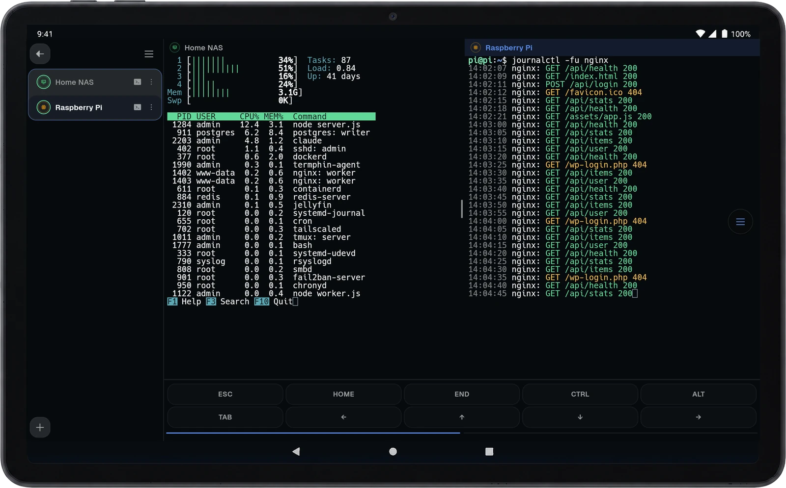

[](https://termphin.dev)

<h1 align="center">Termphin</h1>

<p align="center">
  <b>Never lose an SSH session again.</b><br>
  An SSH client whose sessions survive a dropped connection - lock the phone,<br>
  change networks, come back to the same shell.
</p>

<p align="center">
  <a href="https://termphin.dev/download">Download</a> ·
  <a href="https://termphin.dev/docs/">Manual</a> ·
  <a href="https://termphin.dev/changelog">Changelog</a> ·
  <a href="../../issues/new?template=bug_report.yml">Report a bug</a> ·
  <a href="../../issues/new?template=idea.yml">Suggest an idea</a>
</p>

---

## Why Termphin

- **Persistent sessions.** A lightweight helper on the server holds your shell
  open. Reconnect and pick up right where you left off.
- **Clean TUI rendering.** Drawn directly by Flutter, not in a web view. htop,
  vim and other TUIs render without broken box characters.
- **Encrypted local vault.** Keys and passwords are sealed with AES-256-GCM,
  under a key your phone's secure hardware holds.

<p align="center">
  
</p>

## Download

<a href="https://play.google.com/store/apps/details?id=dev.termphin.termphin"></a>

| Platform | Status |
|---|---|
| Android | [Google Play](https://play.google.com/store/apps/details?id=dev.termphin.termphin), or the APK from [Releases](../../releases/latest) |
| iOS | Coming soon |
| macOS, Windows, Linux | Work in progress |

The APK on Releases is signed with a different key than the Google Play build,
so one does not update the other - uninstall first to switch. Each APK comes
with a SHA-256 checksum and a build provenance attestation:
`gh attestation verify termphin-<version>.apk -R Termphin/Termphin`.

## Built for productivity

- **Split screen** - two sessions side by side in one tab; drag the divider, swap the panes
- **Files beside the shell** - browse, upload, download and rename over the same connection
- **Autocomplete** - commands and paths from your own history, suggested as you type
- **Fast upload** - pick a file and it lands on the server, with its path pasted at the prompt
- **A real text editor** - syntax highlighting in your terminal colours, find and replace
- **Host key pinning** - a changed server key is stopped, not waved through
- **SSH tunnels** - local and remote port forwards, saved on a machine or opened for one session
- **Snippets** - save a command with arguments and run it on several machines at once
- **Key toolbar** - Esc, Tab, Ctrl and arrows above the keyboard, in layouts you arrange
- **Action dock** - a floating button for paste, snippets and fast upload
- **Jump hosts** - reach machines behind a bastion, the way ProxyJump does
- **Fallback addresses** - one machine, a LAN and a Tailscale address, whichever answers
- **Two-factor sign-in** - one-time codes and PAM prompts asked for in the app
- **Reconnects on its own** - retries until the network is back, keeps what you type meanwhile
- **Predictive echo** - on a slow link, what you type shows before the server answers
- **Connection health** - a quiet warning when replies slow down or stop
- **14 color schemes** - dark and light themes, with font, size, cursor and padding to match
- **Encrypted backups** - export everything to one file, sealed with a passphrase

## Issues

Before you open an issue, search the existing ones. If yours is already there,
add a comment instead. Never paste a private key or password. To hide
hostnames and usernames in screenshots, turn on **Anonymize** in Settings.

Found a vulnerability? Do not open an issue. See [SECURITY.md](SECURITY.md).

## Building

```bash
flutter pub get
flutter run
```

| Command | |
|---|---|
| `flutter analyze` | lint |
| `flutter test` | tests |
| `dart run slang` | regenerate i18n after editing `lib/i18n/strings_en.i18n.json` |
| `scripts/build_release.sh [android\|ios]` | release build |

How the app is put together is written down in
[docs/architecture](docs/architecture/overview.md).

The committed `android/app/debug-keystore.jks` is the public AOSP debug key and
is meant to be there. Release signing keys are not in this repository.

## Contributing

See [CONTRIBUTING.md](CONTRIBUTING.md).

## Related repositories

- [terminal_view](https://github.com/Termphin/terminal_view) - the terminal widget, a fork of xterm
- [termphin-agent](https://github.com/Termphin/termphin-agent) - the server helper that keeps sessions alive

## License

Termphin is free software: you can redistribute it and/or modify it under the
terms of the [GNU General Public License](LICENSE), version 3 or (at your
option) any later version, with the [additional terms](ADDITIONAL-TERMS.md)
section 7 of that license allows - chiefly a permission to distribute
through app stores.

The name Termphin and its logo are not covered by that license - see the
[trademark policy](TRADEMARKS.md). A fork you distribute needs its own name
and icon.
